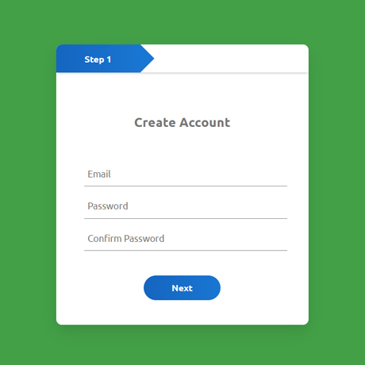

# Multi-Step Form

A sign-up form split into three steps with a progress bar.

## Features

- Next and back buttons between steps
- Progress indicator

## Run it

No build step. Open `index.html` in a browser, or serve the folder with any static server, for example `python -m http.server`.

## Screenshots

